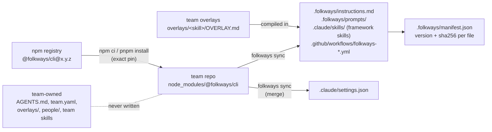

# How it works

The mechanics under [Concepts](concepts.md): how framework files reach a team repo, who owns what,
how upgrades land, and how the review gate stays honest. Details and reasoning:
[v1 spec §3 and §7](../design/06-v1-spec.md).

## Code runs from npm, text lives in git

folkways delivers two kinds of thing, two ways:

- **Code** (the CLI, and hooks when they land) runs from the pinned package in `node_modules/`. The team
  repo's `package.json` and lockfile set the version, so everyone runs the same one.
- **Text** (instructions, skills, prompts, workflows) has to be real files in the repo, because the
  tools read skills from `.claude/skills/`. `folkways sync` copies them in from the installed package.
  Today that's `instructions.md`, the skills and the prompts; workflows are coming soon.

A nice side effect: every framework change shows up in an upgrade PR's diff, readable like any change.

The design, end to end (today the package isn't on npm, and no workflows or hooks ship yet):

## Who owns what

| Path | Owner | What `sync` does |
|---|---|---|
| `.folkways/**` | framework | replaces |
| `.claude/skills/<name>/` listed in the manifest | framework | replaces; the output includes your team overlay, compiled in |
| `.github/workflows/folkways-*.yml` | framework | replaces |
| `.claude/settings.json` hook entries whose command contains `folkways hook ` | framework | replaces those entries; leaves every other key and entry alone (no hooks ship yet) |
| `.claude/settings.json` framework `permissions.ask` rules | framework | adds if missing; never removes |
| `AGENTS.md` | team | never writes after `init`; warns if the `@.folkways/instructions.md` line is missing |
| `.local/me` (link to `people/<handle>/`) | person | creates or fixes the link; removes one that points at another person, and warns |
| everything else: `team.yaml`, `overlays/`, `people/`, team skills, `package.json` | team or person | never writes |

The team `AGENTS.md` pulls in the framework rules with one line, `@.folkways/instructions.md`. Claude
Code and Copilot CLI both expand `@` imports there. `CLAUDE.md` is just `@AGENTS.md`.

## What sync does

`folkways sync`, run inside the team repo, copies from the **installed** package version:

1. **Checks for edits.** Every file in `.folkways/manifest.json` is compared against its sha256. Files
   added inside a framework skill folder count too. If anything changed, sync **stops**, lists the files,
   and suggests moving the change into `overlays/`. `--force` discards the edits.
2. **Checks for clashes.** If a team skill has the same name as a new framework skill, sync stops and
   asks you to rename yours.
3. **Compiles team overlays.** Each `overlays/<skill>/OVERLAY.md` is applied to its synced skill:
   `## Override {#id}` replaces that section, `## Add` goes under `## Team additions`. An unknown ID, or
   overriding a section and its subsection, stops the sync before any write. The manifest records a
   checksum per overlay.
4. **Writes.** Replaces framework files, merges `.claude/settings.json`, writes the new manifest.
5. **Lints and links.** Personal overlays that try to override get a warning. `.local/me` is pointed at
   `people/<handle>/` so skills can attach your overlay. Warnings don't fail the sync.

It never commits. You look at `git status`, then commit. Refusing to clobber an edit is the whole point:
customizations belong in overlays, where upgrades can't reach them. Rerun `sync` after you change a
team overlay so it's compiled in ([ADR 0001](../adr/0001-overlay-enforcement.md)).

## Upgrades

`folkways upgrade 0.2.0`:

1. Refuses on a dirty tree, or if framework files were edited.
2. Creates branch `chore/folkways-0.2.0` (refuses if it exists).
3. Installs `@folkways/cli@0.2.0` as an exact dev dependency, with the team's own package manager
   (npm or pnpm, detected from `packageManager` or the lockfile).
4. Runs the **new** version's `sync`, so its rules apply.
5. Commits `chore(folkways): upgrade to 0.2.0`. If nothing changed, it deletes the branch and says so.

If a step fails, it puts you back on your branch and cleans up what it created. You read the diff, push
and open the PR. Teammates reinstall after pulling. A Dependabot or Renovate bump works too: install and
run `folkways sync` on its branch.

## The review gate

We want every change reviewed by someone who didn't write it. With agents, the author's context is the
risk: an agent that just spent an hour on a change will review it through that hour's assumptions.

So the review runs in a **fresh process**:

- `folkways review` starts a separate headless CLI with a fixed prompt, `.folkways/prompts/review.md`,
  filled with the repo, branch, base, HEAD SHA, ticket and effort. The working agent can't frame it.
- The reviewer reviews against intent first (ticket, design, knowledge), verifies by running, then writes
  a verdict and a findings table using [Conventional Comments](https://conventionalcomments.org/).
- Output goes to `<effort>/NN-review-<sha7>.md`, with the full SHA in its frontmatter.
- The team picks when it runs in `team.yaml` (`review.trigger`), and a person can differ in `me.yaml`:

| Trigger | When |
|---|---|
| `on-demand` | Only when asked |
| `after-commit` | The `commit` skill runs it after each commit |
| `pre-push` | `git-guard` blocks the push until a review covers HEAD |

**Coming soon:** `folkways review` and `git-guard`. The prompt and the `commit` and `review` skills
ship; the command says "not built yet" and nothing blocks a push yet. The gate is agent-side by design: no CI checks in project repos
in v1.

That's how we trust each other's code. 🙌
