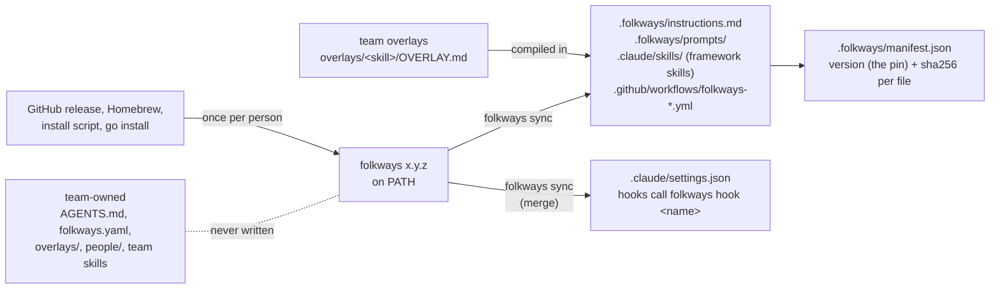

# How it works

The mechanics under [Concepts](concepts.md): how framework files reach a team repo, who owns what,
how upgrades land, and how the review gate stays honest. Details and reasoning:
[v1 spec §3 and §7](https://github.com/sumsolution/folkways-command/blob/14c47bd/efforts/v1-design/06-v1-spec.md).

## Code runs from one binary, text lives in git

folkways delivers two kinds of thing, two ways:

- **Code** (the CLI and the hooks) is one binary, `folkways`, which each person installs once and runs from
  `PATH` ([Install](../../README.md#install)). The hooks in `.claude/settings.json` call `folkways hook <name>`
  and do nothing when it's missing ([ADR 0012](../adr/0012-cli-only.md)).
- **Text** (instructions, skills, prompts, workflows) has to be real files in the repo, because the
  tools read skills from `.claude/skills/`. The binary carries the text of its version, and `folkways sync`
  copies it in. Today that's `instructions.md`, the skills and the prompts; workflows are coming soon.

The pin is the `version` in `.folkways/manifest.json`, the version the repo was last synced from. When someone's
`folkways` differs, each session starts with a warning, and `folkways doctor` reports it.

A nice side effect: every framework change shows up in an upgrade PR's diff, readable like any change.

The design, end to end (no workflows ship yet):

## Who owns what

| Path | Owner | What `sync` does |
|---|---|---|
| `.folkways/**` | framework | replaces |
| `.claude/skills/<name>/` listed in the manifest | framework | replaces; the output includes your team overlay, compiled in |
| `.github/workflows/folkways-*.yml` | framework | replaces |
| `.claude/settings.json` hook entries the framework owns | framework | replaces those entries; leaves every other key and entry alone |
| `.claude/settings.json` framework `permissions.ask` rules | framework | adds if missing; removes only the old `Bash(git push:*)`, exactly that string, even one a person added (ADR 0014) |
| `AGENTS.md` | team | never writes after `init`; warns if the `@.folkways/instructions.md` line is missing |
| everything else: `folkways.yaml`, `overlays/`, `people/`, team skills | team or person | never writes |

The team `AGENTS.md` pulls in the framework rules with one line, `@.folkways/instructions.md`. Claude
Code and Copilot CLI both expand `@` imports there. `CLAUDE.md` is just `@AGENTS.md`.

## What sync does

`folkways sync`, run inside the team repo, copies the files of the **running** `folkways` version:

1. **Checks for edits.** Every file in `.folkways/manifest.json` is compared against its sha256. Files
   added inside a framework skill folder count too. If anything changed, sync **stops**, lists the files,
   and suggests moving the change into `overlays/`. `--force` discards the edits.
2. **Checks for clashes.** If a team skill has the same name as a new framework skill, sync stops and
   asks you to rename yours.
3. **Compiles team overlays.** Each `overlays/<skill>/OVERLAY.md` is applied to its synced skill:
   `## Override {#id}` replaces that section, `## Add` goes under `## Team additions`. An unknown ID, or
   overriding a section and its subsection, stops the sync before any write. The manifest records a
   checksum per overlay.
4. **Writes.** Replaces framework files, merges `.claude/settings.json`, writes the new manifest.

It never commits. You look at `git status`, then commit. Refusing to clobber an edit is the whole point:
customizations belong in overlays, where upgrades can't reach them. Rerun `sync` after you change a
team overlay so it's compiled in ([ADR 0001](../adr/0001-overlay-enforcement.md)).

## Upgrades

`folkways upgrade 0.2.0`:

1. Refuses on a dirty tree, if framework files were edited, or if branch `chore/folkways-0.2.0` exists.
2. Refuses unless the running `folkways` is 0.2.0: install it first. The new version's `sync` runs, so its rules
   apply.
3. Creates the branch and syncs, which moves the manifest's `version` to 0.2.0.
4. Commits `chore(folkways): upgrade to 0.2.0`. If nothing changed, it deletes the branch and says so.

If a step fails, it puts you back on your branch and cleans up what it created. You read the diff, push
and open the PR. Teammates install 0.2.0 after pulling; until then their sessions start with a warning.

## The review gate

We want every change reviewed by someone who didn't write it. With agents, the author's context is the
risk: an agent that just spent an hour on a change will review it through that hour's assumptions.

So the review runs in a **fresh process**:

- `folkways review` starts a separate headless CLI with a fixed prompt, `.folkways/prompts/review.md`,
  filled with the repo, branch, base, HEAD SHA, ticket and effort. The working agent can't frame it.
- The reviewer reviews against intent first (ticket, design, knowledge), verifies by running, then writes
  a verdict and a findings table using [Conventional Comments](https://conventionalcomments.org/).
- Output goes to `<effort>/NN-review-<sha7>.md`, with the full SHA in its frontmatter.
- The team picks when it runs in `folkways.yaml` (`review.trigger`), and a person can only tighten it in `me.yaml`:

| Trigger | When |
|---|---|
| `on-demand` | Only when asked |
| `after-commit` | The `commit` skill runs it after each commit |
| `pre-push` | `git-guard` blocks a project repo's push until a review covers HEAD; the brain repo pushes without one |

**Coming soon:** `folkways review`. The prompt, the `commit` and `review` skills and `git-guard` ship;
the command says "not built yet", so with `pre-push` the review file has to come from the `review` skill. The gate is agent-side by design: no CI checks in project repos
in v1.

That's how we trust each other's code. 🙌
